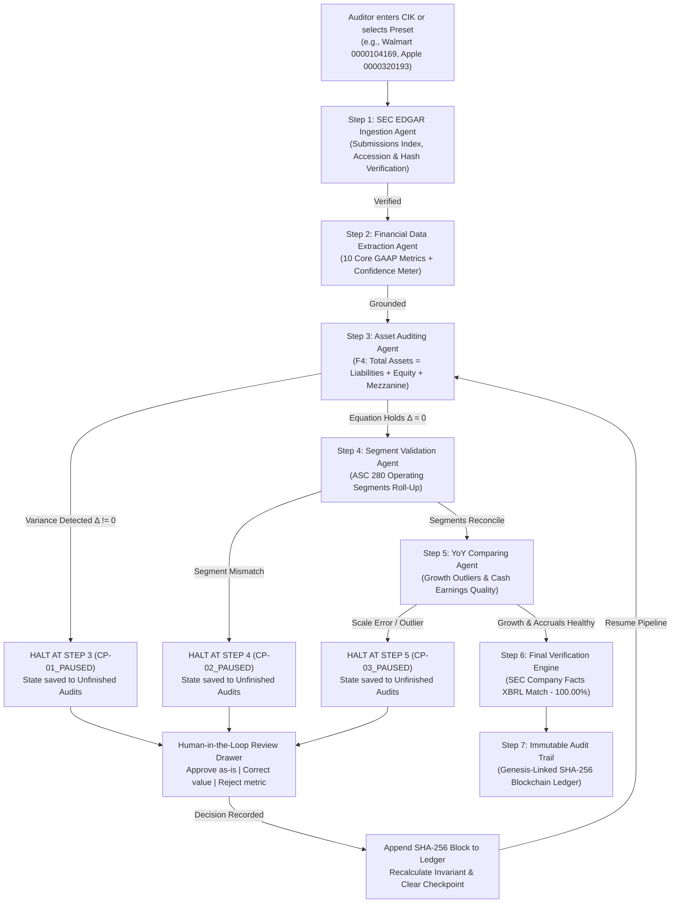

# V.A.U.L.T (Verifiable Auditing & Unsupervised Ledger Testing)
**Human-in-the-Loop Financial Filing Auditor Agent**

---

## 1. Problem Overview
Financial auditing of SEC Form 10-K filings is high-stakes, time-consuming, and prone to severe hallucinations when automated via standard Large Language Models (LLMs). LLMs regularly confuse table scaling factors ("in thousands" vs "in millions"), misinterpret prior-year columns, flip signs, and fail exact mathematical identities.

**V.A.U.L.T** replaces non-deterministic guesswork with a verifiable, human-in-the-loop autonomous auditing system:
- **Deterministic Extraction:** Correlates SEC EDGAR XBRL facts directly with verbatim HTML table row snippets.
- **4-Factor Confidence Scoring:** Evaluates source grounding, taxonomy labeling, unit/scaling clarity, and historical YoY stability.
- **Three Specialized Auditing Agents:**
  1. *Asset Auditing Agent:* Verifies fundamental balance sheet equilibrium ($A = L + E + TE$) with ASC 480 mezzanine and redeemable noncontrolling interest (NCI) support.
  2. *Segment Validation Agent:* Reconciles ASC 280 operating segments against consolidated reported revenues.
  3. *YoY Comparing Agent:* Detects multi-period volatility outliers, 1,000x scaling errors, and evaluates cash earnings quality (Operating Cash Flow $\ge$ Net Income).
- **Sequential Agentic Orchestrator:** Agents execute step-by-step without advance calculation. If an invariant check fails, the workflow halts at that exact step.
- **Stateful Durable Resumption:** Automatically saves paused runs into *Unfinished audits & persisted checkpoints*. Auditors can review verbatim source snippets, choose *Approve as-is*, *Correct value*, or *Reject metric*, and resume execution.
- **Cryptographic Auditability:** Decisions, timestamps, and justification notes are sealed in an append-only SHA-256 hash-chained ledger.
- **Ground Truth Benchmarking:** Validates final extracted data against official SEC Company Facts XBRL ground truth (target 100.00% accuracy).

---

## 2. Agentic Workflow Architecture



---

## 3. Exact Tech Stack

### Backend & Agent Engine
- **Language & Runtime:** Python 3.11+
- **Web API Framework:** `fastapi` (v0.115.0+) — asynchronous ASGI routing, dependency injection, and OpenAPI contract documentation.
- **ASGI Web Server:** `uvicorn[standard]` (v0.32.0+) — high-throughput async event loop with auto-reloading and static file serving.
- **Data Validation & Typing:** `pydantic` (v2.9.0+) — strict schema enforcement, input coercion, and JSON serialization.
- **State Machine & Durable Persistence:** Python deterministic finite state machine (FSM) backed by `sqlite3` (`data/checkpoints.sqlite`) enforcing LangGraph checkpoint patterns (`WAITING_FOR_REVIEW`, idempotent HTTP 409 rejection).
- **HTTP Client & SEC EDGAR Networking:** `httpx` (v0.27.0+) — connection pooling, strict SEC rate-limiting (10 req/sec), custom `User-Agent` headers, and local disk cache fallback.
- **XML & HTML Parsing:** `lxml` (v5.2.0+) — C-accelerated XPath navigation, XML schema validation, and HTML table row snippet isolation with byte-offset text matching.
- **SEC Tooling:** `edgartools` (v6.0.0+) + SEC Company Facts XBRL JSON APIs.
- **Data Processing & Tabular Data:** `pandas` (v2.2.0+), `numpy` (v1.26.0+), `pyarrow` (v15.0.0+ / v17.0.0+) for high-performance memory-mapped financial tables.
- **Machine Learning & Statistical Volatility:** `scikit-learn` (v1.4.0+ / v1.5.0+), `joblib` (v1.3.0+ / v1.4.0+) for multi-period outlier isolation and earnings quality accrual ratios.
- **Configuration Management:** `pyyaml` (v6.0.2+) for dynamic threshold policies (`config/thresholds.yaml`).

### Frontend & Human-in-the-Loop Interface
- **Architecture:** Zero-dependency Vanilla ES2022+ Single-Page Application (`app/static/index.html`) — sub-100ms interaction latency with zero build-step or node_modules bloat.
- **Design System:** Strict implementation of `design.md` via CSS3 Custom Properties (`--bg: #F8FAF9`, `--primary: #0F5A47`, `--surface: #FFFFFF`, `--border: #E2E8E5`), WCAG AA compliant contrast ratios.
- **Client-Side Cryptography:** W3C Web Crypto API (`window.crypto.subtle.digest('SHA-256', ...)`) for dynamic block hashing, parent-hash linkage, and tamper detection.
- **Local Persistence & Rehydration:** Browser `localStorage` for `vault_checkpoint_state` and `vault_unfinished_runs` recovery across browser refreshes.
- **Iconography:** Inline lightweight SVG vectors (clean financial/audit stroke set).
- **Secondary Analytics Workbench:** `streamlit` (`dashboard/app.py`) for analytical review.

### Testing & Verification
- **Test Runners:** Python standard library `unittest` and `pytest` (v8.3.0+).
- **End-to-End Verification:** Dedicated smoke test harness (`scripts/smoke_test.py`) validating error injection, review queues, HTTP 409 idempotency, and cryptographic hash chains.

---

## 4. Quickstart: Run on Windows

1. **Open PowerShell** and navigate to the project root:
   ```powershell
   cd E:\VAULT
   ```
2. **Activate the Virtual Environment**:
   ```powershell
   .\.venv\Scripts\Activate.ps1
   ```
3. **Verify Dependencies**:
   ```powershell
   .\.venv\Scripts\python.exe -m pip install -r requirements.txt
   ```
4. **Set SEC Compliance User-Agent**:
   ```powershell
   $env:SEC_USER_AGENT = "VaultAuditor team@vault.internal"
   ```
5. **Run the Unit Test Suite**:
   ```powershell
   .\.venv\Scripts\python.exe -m unittest discover tests
   ```
6. **Execute the End-to-End Smoke Test**:
   ```powershell
   .\.venv\Scripts\python.exe scripts\smoke_test.py
   ```
7. **Start the V.A.U.L.T Web Application**:
   ```powershell
   .\.venv\Scripts\python.exe -m uvicorn app.main:app --host 127.0.0.1 --port 8000
   ```
8. **Open in Browser**:
   Navigate to [http://127.0.0.1:8000](http://127.0.0.1:8000).

---

## 5. Quick-Select Presets & Scenarios

| Monogram | Entity Name | CIK | Fiscal Year | Scenario Description | Expected Agent Behavior |
| :--- | :--- | :--- | :--- | :--- | :--- |
| **AA** | Apple Inc. | `0000320193` | 2024 | Clean baseline | All 3 validation agents pass. No checkpoints triggered. 100.00% accuracy. |
| **WM** | Walmart Inc. | `0000104169` | 2026 | Wrong column carryover | Prior-year liabilities (\$163,131M) extracted instead of \$178,488M. Asset Auditing Agent halts at `CP-01_PAUSED` with $\Delta = -\$15,357\text{M}$. Correcting value to \$178,488M unblocks pipeline. Evaluates ASC 480 Mezzanine Equity (\$293M). |
| **MS** | Microsoft Corp. | `0000789019` | 2024 | Balance sheet mismatch | Balance sheet equity variance. Asset Auditing Agent halts at `CP-01_PAUSED`. |
| **NV** | NVIDIA Corp. | `0001045810` | 2024 | Scale anomaly (1,000x) | Net income extracted as \$29,760,000M instead of \$29,760M (+681,218% YoY). YoY Comparing Agent halts at `CP-03_PAUSED`. Correcting scalar resumes pipeline. |
| **KO** | The Coca-Cola Co. | `0000021344` | 2024 | Segment roll-up | Validates geographic & operating segments against consolidated revenue. |
| **NF** | Netflix, Inc. | `0001065280` | 2024 | Mezzanine equity | Reconciles temporary equity balances. |

---

## 6. Repository File Map

```
E:\VAULT
├── agent/                       # Workflow state machine & audit logic
│   ├── audit.py                 # SHA-256 cryptographic hash-chained audit trail
│   ├── config.py                # Dynamic configuration loader & hot-reloading
│   ├── graph.py                 # SQLite checkpointer & pause/resume state machine
│   ├── nodes.py                 # Idempotent step execution nodes
│   └── state.py                 # Pydantic & TypedDict workflow state definitions
├── app/                         # FastAPI backend & web frontend
│   ├── api/runs_routes.py       # REST API endpoints (/runs, /reviews, /audit-log)
│   ├── api/yoy_routes.py        # Multi-period trend and accrual comparison routes
│   ├── static/index.html        # Single-page autonomous agentic auditor UI
│   └── main.py                  # FastAPI application entrypoint & static mounting
├── config/                      # Agent settings & guardrails
│   └── thresholds.yaml          # Confidence limits, YoY tolerance, auto-approve flag
├── dashboard/                   # Scripted demo timelines & analytical tools
│   ├── demo_timeline.json       # Deterministic pre-pause & post-resume event streams
│   └── mock_data.json           # Offline demo dataset
├── data/                        # Persistent storage (auto-created)
│   ├── cache/                   # SEC EDGAR raw JSON & XBRL disk cache
│   └── checkpoints.sqlite       # Durable SQLite state checkpoints
├── docs/                        # Specifications, contracts & defense docs
│   ├── CONTRACT.md              # Shared data contract & REST API specifications
│   ├── DEMO_SCRIPT.md           # Demonstration script
│   └── JUDGE_QA.md              # Defense questions and technical answers
├── pipeline/                    # Deterministic data extraction & validation engine
│   ├── accuracy.py              # Precision, recall, and escalation metrics calculator
│   ├── edgar_client.py          # SEC client with local fixture fallback
│   ├── error_injection.py       # Deliberate corruption generator for demo testing
│   ├── extractor.py             # 10 financial metrics extractor + HTML table parser
│   ├── ground_truth.py          # SEC XBRL Company Facts API client
│   ├── scoring.py               # 4-factor confidence scoring implementation
│   └── validators.py            # Unified runner for accounting, segment & YoY checks
├── scripts/                     # Verification & operational test scripts
│   └── smoke_test.py            # Automated end-to-end smoke test script
├── tests/                       # Formal test suites (unittest)
│   ├── test_accounting_equation.py          # Balance sheet F1, F2, F4 equation tests
│   ├── test_api_endpoints.py                # REST route input validation and HTTP 409 tests
│   ├── test_audit_chain.py                  # Cryptographic SHA-256 hash-chain tests
│   ├── test_pipeline_real.py                # Multi-company extraction & validation tests
│   ├── test_validation_accounting_equation.py # Adversarial tampering & mezzanine tests
│   ├── test_workflow_reliability.py         # Crash simulation & SQLite idempotency tests
│   └── test_yoy.py                          # Multi-period variance and accrual tests
├── walmart_10k_tampered_report.json # Adversarial test dataset for wrong-column carryover
├── design.md                    # Visual token and UI/UX design specifications
└── requirements.txt             # Locked project dependencies
```

---

## 7. Mapping Judging Criteria to Implementations

| # | Judging Criterion | Implementation Feature | Primary Source Files |
| :-- | :-- | :-- | :-- |
| **1** | **Extraction Accuracy** | Extracts 10 standard GAAP metrics with verbatim HTML table row snippets, unit scaling, and tag fallbacks. | [`pipeline/extractor.py`](file:///e:/VAULT/pipeline/extractor.py), [`app/static/index.html`](file:///e:/VAULT/app/static/index.html) |
| **2** | **Confidence Scoring** | 4-factor score ($0.40 \cdot G + 0.25 \cdot L + 0.20 \cdot U + 0.15 \cdot \text{YoY}$) with dynamic thresholds. | [`pipeline/scoring.py`](file:///e:/VAULT/pipeline/scoring.py), [`config/thresholds.yaml`](file:///e:/VAULT/config/thresholds.yaml) |
| **3** | **Agentic Sequential Execution** | True step-by-step agent workflow without advance calculations. Halts at specific failed invariant checkpoints. | [`app/static/index.html`](file:///e:/VAULT/app/static/index.html), [`agent/nodes.py`](file:///e:/VAULT/agent/nodes.py) |
| **4** | **Human-in-the-Loop Review** | Drawer workbench with source snippet highlighting, Approve/Correct/Reject actions, and auditor justification notes. | [`app/static/index.html`](file:///e:/VAULT/app/static/index.html), [`app/api/runs_routes.py`](file:///e:/VAULT/app/api/runs_routes.py) |
| **5** | **State Persistence & Resume** | Persists paused checkpoint states to local storage and SQLite. Resumes from the exact step without duplicate execution. | [`app/static/index.html`](file:///e:/VAULT/app/static/index.html), [`agent/graph.py`](file:///e:/VAULT/agent/graph.py) |
| **6** | **Accounting Rigor** | Verifies $A = L + E + TE$ with ASC 480 mezzanine equity, ASC 280 segment roll-ups, and cash earnings quality. | [`tests/test_accounting_equation.py`](file:///e:/VAULT/tests/test_accounting_equation.py), [`pipeline/validators.py`](file:///e:/VAULT/pipeline/validators.py) |
| **7** | **Cryptographic Auditability** | Append-only SHA-256 hash-chained decision log with instant cryptographic tamper verification and timestamped diffs. | [`agent/audit.py`](file:///e:/VAULT/agent/audit.py), [`tests/test_audit_chain.py`](file:///e:/VAULT/tests/test_audit_chain.py) |
| **8** | **Zero-Dependency Native UI** | Fast single-page application complying with `design.md` design system, semantic HTML, WCAG AA contrast, and zero external framework bloat. | [`app/static/index.html`](file:///e:/VAULT/app/static/index.html), [`design.md`](file:///e:/VAULT/design.md) |
